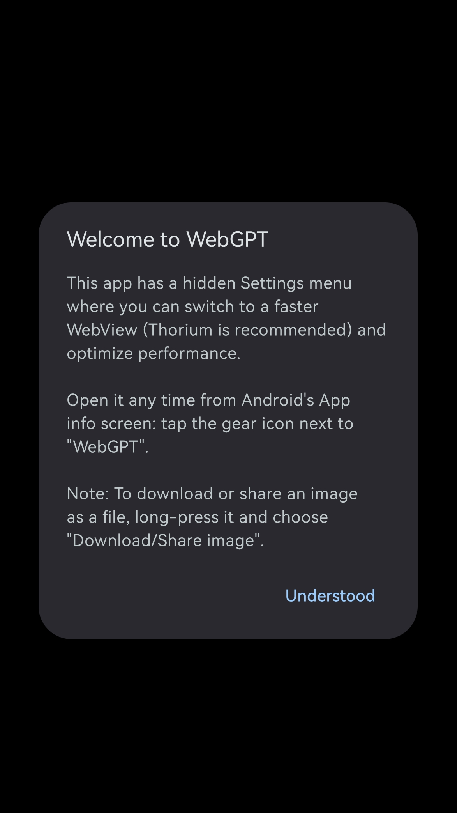
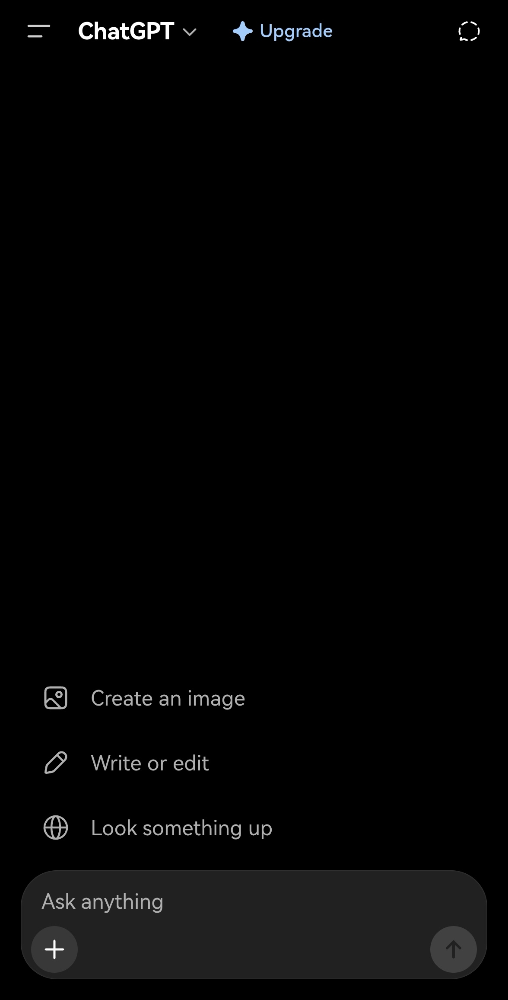
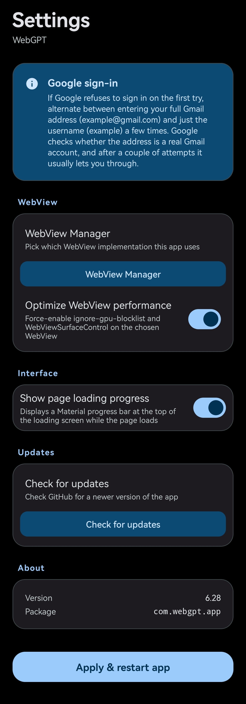
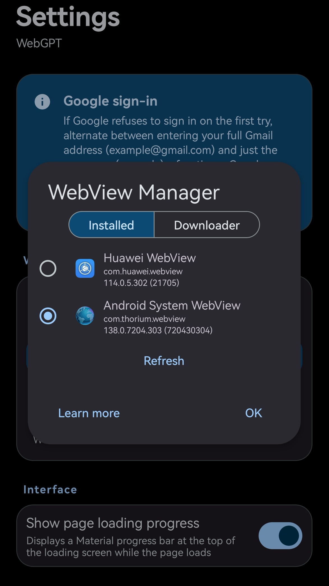
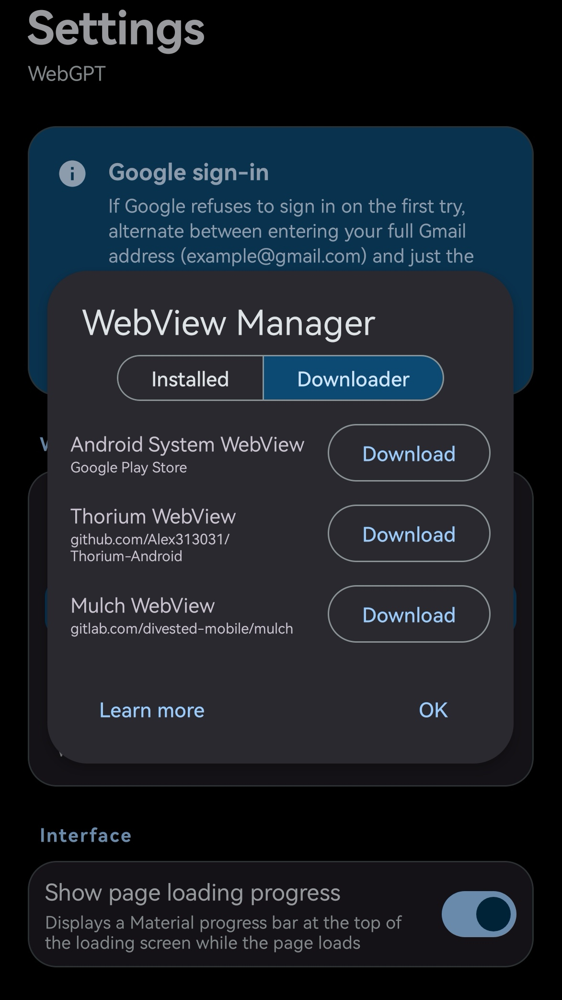

# WebGPT

**ChatGPT in an Android WebView, built for phones without Google services.**

> **WebGPT is an independent, unofficial client.** It is not affiliated with, endorsed by, or sponsored by OpenAI. The WebGPT name, icon and source code are this project's own and do not use the ChatGPT trademark or logo. WebGPT loads the public `chatgpt.com` website inside an Android WebView, the same way any general-purpose browser would.

## Screenshots

  
  
  

  
  

## Downloads

| Source | Link |
| --- | --- |
| F-Droid | [org.webgpt.app](https://f-droid.org/packages/org.webgpt.app/) |
| GitHub Releases | [Latest release](https://github.com/MrHuaweiFan/WebGPT/releases/latest) |

## Why WebGPT?

Many phones have no Google Play Services, and their built-in WebView is often old or broken. WebGPT lets you pick a different WebView from inside the app, so ChatGPT works on those devices. The choice only affects WebGPT, not other apps.

## Features

### Chatting
- **Stays signed in.** Your session is saved between launches.
- **Pure black dark mode.** Black in dark mode, `#FCFCFC` in light mode. The status and navigation bars follow system dark/light switches live, without a restart.
- **Smooth loading screen.** A spinning logo that fades out with no white flash. An optional page-progress bar can be turned on in Settings.
- **Privacy.** Third-party cookies are blocked on the main page. Sign-in popups keep them, so Google sign-in still works.
- **Links open where they should.** Links to other sites open in your default browser, with no black or white flash in between.

### Files and images
- **Upload** several files at once, or take a photo with the camera.
- **Download** generated files, PDFs, Word documents and Markdown exports to your `Download` folder.
- **Long-press an image** to share it or save it.

### Sharing
- **Share to WebGPT** from any app. Shared text is copied to the clipboard and shared files are attached to the chat for you.
- **Ask WebGPT** appears in the text-selection menu and copies the selected text to the clipboard.
- **Share and Copy buttons** inside ChatGPT use Android's own share sheet and clipboard.
- **Camera and microphone** permissions are requested only when the site asks for them.

### WebView switcher
- Choose between 13 WebView providers: Android System WebView, Chrome (stable, beta, dev, canary), Thorium, Mulch, Huawei WebView and Amazon WebView.
- A built-in downloader tab links to Google Play, Thorium (GitHub) and Mulch (GitLab).
- If the app crashes 3 times in a row, it sends you to Settings so you can pick another WebView.
- An optional "Optimize WebView performance" switch can improve speed on some devices.

## Getting started

1. Install WebGPT and open it.
2. Sign in with email or Google.
3. To open the hidden Settings, go to Android **Settings → Apps → WebGPT** and tap the gear icon. There you can pick a WebView, show the page-progress bar and check for updates.

## Known limitations

- **Voice dictation** may refuse to start even with permissions granted. Switching to another WebView can fix it.
- **Google sign-in** is sometimes blocked by Google in Android WebViews ("browser or app may not be secure"). Email sign-in works, and trying another WebView can help.
- **The chat's own Share button** is unreliable on some devices. Long-press an image and choose "Share image" instead.

## Requirements

Android 5.0 (API 21) or newer.

## For developers

| Document | What it covers |
| --- | --- |
| [BUILD.md](BUILD.md) | How to build and sign the app |
| [WEBSITE_SPECIFICS.md](WEBSITE_SPECIFICS.md) | Everything specific to `chatgpt.com`: what went wrong with the site, how WebGPT works around it, and a porting guide |
| [WEBVIEW_SWITCHER.md](WEBVIEW_SWITCHER.md) | How the in-app WebView switcher works |

WebGPT is the base app of a family of WebView wrappers for other websites. Each app in the family has its own `WEBSITE_SPECIFICS.md`. In WebGPT it lists everything tied to `chatgpt.com`. In a derived app it lists what that app changed. If you fork WebGPT for another site, read that file first. It tells you what to change and what to leave alone.

The app is written in Kotlin with Material 3. Tech stack: AGP 8.2.2, Gradle 8.5, JDK 17+, compileSdk 34, minSdk 21, targetSdk 34, Material 1.12.0, androidx.recyclerview 1.3.2, androidx.webkit 1.10.0, androidx.core-splashscreen 1.0.1, R8 enabled.

## Credits

- Based on the [webapp](https://github.com/wskang12138/webapp) template by `wskang12138`.
- Inspired by [duckAssist](https://github.com/diekaiju/duckAssist). The idea for this app came from trying it.
- The WebView switcher is reverse-engineered from Better xCloud.
- Built with **GLM agent mode through Z.AI** and **Claude Code** (v6.29+).

## License

WebGPT is free software under the [MIT License](LICENSE).
